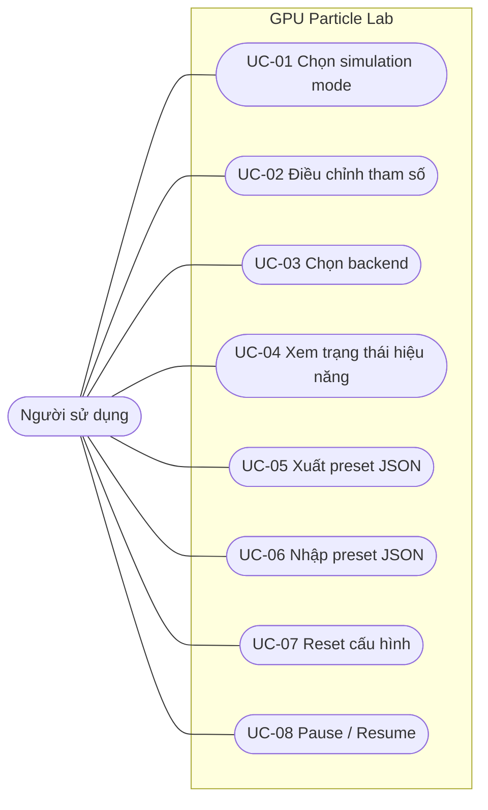

# Use Cases — Particle Lab (TV4, v0.1)

**Dự án:** 3D-WEB-05

**Actor chính:** Người sử dụng (User)

**Phạm vi:** tương tác UI, lựa chọn mô phỏng, quan sát hiệu năng và preset.

**Chú thích:** bản phân tích đề xuất cho SRS; phần GPU chưa tích hợp.

## 1. Use Case Diagram

Sơ đồ dạng Mermaid mô tả actor và quan hệ tương tác. Khi làm báo cáo UML chính thức, nhóm có thể vẽ lại theo ký pháp Use Case UML.

## 2. Danh sách Use Case

| ID | Tên | Tiền điều kiện | Kết quả mong đợi | Trạng thái tuần 1 |
|---|---|---|---|---|
| UC-01 | Chọn simulation mode | UI đã mở | Chuyển mode, controls đổi theo mode | **Mock UI** |
| UC-02 | Thay đổi tham số | UI đã mở | Giá trị hiển thị và state cập nhật | **UI hoạt động**, chưa nối engine |
| UC-03 | Chọn backend | UI đã mở | Ghi backend mong muốn, backend thực tế vẫn hiển thị đúng | **Mock UI** |
| UC-04 | Xem hiệu năng | Có dữ liệu từ engine/perf | Hiển thị FPS / timing hoặc “Không khả dụng” | Chỉ có FPS Canvas2D preview, không phải GPU |
| UC-05 | Xuất preset | Có cấu hình hiện hành | Tải xuống JSON hợp lệ | **Đã có mã TV4** |
| UC-06 | Nhập preset | Người dùng chọn file JSON | Khôi phục controls hoặc báo lỗi | **Đã có mã TV4** |
| UC-07 | Reset cấu hình | UI đã mở | Trở về default | **Đã có mã TV4** |
| UC-08 | Tạm dừng / tiếp tục | Preview đang chạy | Tạm dừng/tiếp tục preview | **Canvas 2D mock** |

## 3. UC-01 — Chọn simulation mode

**Actor:** Người sử dụng

**Precondition:** trang Particle Lab đã tải thành công.

**Main flow:**

1. User chọn **Attractor** hoặc **Vortex**.
2. UI cập nhật trạng thái chọn và thuộc tính `aria-pressed` của hai nút.
3. UI đổi tên mode, mô tả ngắn và nhãn hệ số lực tương ứng.
4. Preview được khởi tạo lại với mode mới.

**Alternative:** nếu engine thật chưa sẵn sàng, thay đổi chỉ tác động đến Canvas2D preview và phải giữ nhãn “NOT GPU”.

**Postcondition:** chỉ một mode được chọn và `config.mode` khớp với trạng thái hiển thị.

## 4. UC-02 — Điều chỉnh tham số

**Actor:** Người sử dụng

**Precondition:** trang Particle Lab đã tải thành công.

**Main flow:**

1. User chọn Attractor/Vortex.
2. User thay đổi particle count, speed, particle size, color hoặc strength.
3. UI kiểm tra phạm vi / định dạng theo control.
4. UI cập nhật cấu hình hiện hành và label giá trị.
5. Khi engine thật sẵn sàng, thay đổi hợp lệ được truyền qua interface do TV1–TV3 thống nhất.

**Alternative:** Khi engine chưa sẵn sàng, UI phải thể hiện rõ đây là preview; không tự nhận đã thực thi mô phỏng GPU.

**Postcondition:** state và giá trị control nhất quán.

## 5. UC-03 — Chọn backend

**Actor:** Người sử dụng

**Main flow (hệ thống hoàn chỉnh):**

1. User chọn Auto / WebGPU / WebGL2.
2. UI gửi `backendPreference` đến core.
3. Core thử khởi tạo backend và xử lý fallback nếu cần.
4. Core phát trạng thái backend thực tế.
5. UI hiển thị backend **thực tế**, thông báo fallback hoặc lỗi nếu có.

**Alternative:** không có WebGPU → core fallback WebGL2 theo thiết kế được chốt; không có GPU timing → hiện “Không khả dụng”.

**Tuần 1:** mới thực hiện bước 1 và lưu state; luôn thông báo backend thực tế là Canvas2D mock.

## 6. UC-04 — Xem FPS / GPU timing

**Actor:** Người sử dụng

**Hệ thống hoàn chỉnh:** chỉ hiển thị FPS / GPU timing thực tế từ perf module. Nếu thiết bị/trình duyệt không hỗ trợ GPU timing, hiển thị “Không khả dụng”. Dữ liệu benchmark phải kèm điều kiện đo.

**Tuần 1:** FPS xem trước chỉ là FPS Canvas2D riêng biệt; GPU timing = “Không khả dụng”.

## 7. UC-05 — Export Preset JSON

**Actor:** Người sử dụng

**Precondition:** UI có cấu hình hợp lệ.

**Main flow:**

1. User bấm **Export JSON**.
2. UI đóng gói `schemaVersion`, `app`, `config`.
3. UI validate cấu hình.
4. Trình duyệt tải file `.json` về máy.

**Postcondition:** JSON có thể import lại mà không mất dữ liệu cấu hình.

## 8. UC-06 — Import Preset JSON

**Actor:** Người sử dụng

**Precondition:** user có file `.json`.

**Main flow:**

1. User bấm **Import** và chọn tệp.
2. UI đọc file, parse JSON và kiểm tra schema, từng trường và phạm vi.
3. Nếu hợp lệ, state, controls và preview được cập nhật cùng lúc.
4. UI thông báo import thành công.

**Exception flows:** JSON lỗi cú pháp, sai schema version, thiếu trường, màu sai dạng, số ngoài phạm vi hoặc tệp lớn hơn 1MB → giữ nguyên state, hiển thị lý do, không crash.

## 9. UC-07 — Reset cấu hình

**Actor:** Người sử dụng

**Precondition:** UI đang hiển thị một cấu hình bất kỳ.

**Main flow:**

1. User bấm **Khôi phục mặc định**.
2. UI thay toàn bộ state bằng `DEFAULT_CONFIG`.
3. Tất cả controls, mode, backend preference và label được đồng bộ.
4. Preview được khởi tạo lại và UI thông báo hoàn tất.

**Postcondition:** giao diện trở về đúng cấu hình mặc định, không giữ sót giá trị cũ.

## 10. UC-08 — Pause / Resume

**Actor:** Người sử dụng

**Precondition:** preview đã khởi tạo.

**Main flow:**

1. User bấm nút pause.
2. UI dừng cập nhật chuyển động và đổi nút thành resume với nhãn trợ năng phù hợp.
3. User bấm resume.
4. UI tiếp tục animation mà không thay đổi cấu hình hiện hành.

**Alternative:** trong bản tích hợp, UI gọi lifecycle API do TV1 thống nhất thay vì điều khiển Canvas2D mock trực tiếp.

**Postcondition:** trạng thái chạy/dừng và biểu tượng nút nhất quán.

## 11. Quy tắc lỗi chung

- Lỗi import không được làm thay đổi cấu hình hiện hành.
- Thiếu GPU timing phải hiển thị “Không khả dụng”, không dùng `0 ms`.
- Backend được yêu cầu không được dùng thay cho backend thực tế.
- Lỗi phải có thông báo bằng chữ và không được làm trang bị crash.

## 12. Traceability

| Use Case | Requirement UI |
|---|---|
| UC-01 | UI-FR-01 |
| UC-02 | UI-FR-02, UI-FR-03 |
| UC-03 | UI-FR-04 |
| UC-04 | UI-FR-05 |
| UC-05 | UI-FR-06 |
| UC-06 | UI-FR-07 |
| UC-07 | UI-FR-08 |
| UC-08 | UI-FR-09 |
