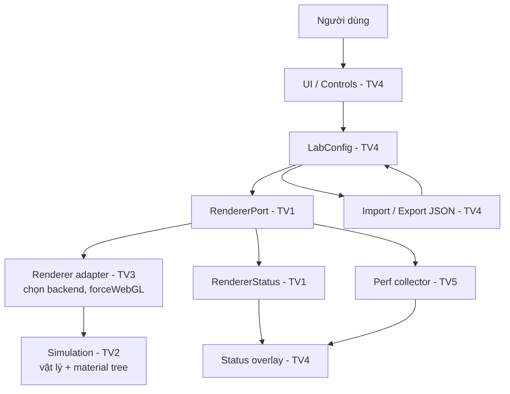

# Thiết kế tương tác & Integration Contract — TV4 v0.2

> Đây là **đề xuất tích hợp** của TV4. `RendererPort` và `RendererStatus` không còn là đề xuất: chúng đã có trong code của TV1 (`src/core/renderer/RendererPort.ts`) và là contract chốt. Các phần còn lại vẫn chờ TV2/TV3/TV5 xác nhận.

## 1. Luồng dữ liệu đề xuất



Chỉ có **một** renderer, không phải một nhánh WebGPU và một nhánh WebGL2 song song.
TV2 sở hữu vật lý và material tree dùng chung; TV3 sở hữu việc chọn backend và
`forceWebGL` bên trong cùng adapter. Xem `docs/05-management/team-ownership.md` §3.1
và `docs/architecture.md` §4.

## 2. State hiện có trong prototype

```ts
type SimulationMode = 'attractor' | 'vortex';
type BackendPreference = 'auto' | 'webgpu' | 'webgl2';

interface LabConfig {
  mode: SimulationMode;
  backendPreference: BackendPreference;
  particleCount: number;
  speed: number;
  particleSize: number;
  particleColor: string; // '#RRGGBB'
  strength: number;
}
```

Code thực tế: src/presets/preset.ts. Module src/ui/app.ts giữ composition tạm; template, controls, notifications và overlay đã tách riêng. TV1/TV2/TV3 cần review ranges và tên biến trước khi chốt interface chung.

### View-model UI hiện có

UiRuntimeState trong src/ui/state/runtimeState.ts chỉ thuộc lớp UI. Nó mô tả initializing, ready, fallback, unsupported và error, cùng actual backend/metrics nullable. Đây không phải interface engine đã được nhóm chốt.

## 3. Giao tiếp tương lai được kiến nghị

```ts
// Trích từ src/core/renderer/RendererPort.ts — contract thật, không phải pseudocode.
interface RendererPort {
  init(target: RendererTarget): Promise<ActualBackend>;
  applyConfig(config: Readonly<LabConfig>): void;
  start(): void;
  pause(): void;
  reset(): void;
  getStatus(): RendererStatus;
  dispose(): void;
}

interface RendererStatus {
  requested: BackendPreference; // 'auto' | 'webgpu' | 'webgl2' — chỉ để giải thích fallback
  actual: ActualBackend;        // 'webgpu' | 'webgl2' | 'unavailable' — backend đã chạy thật
  running: boolean;
  gpuTimingAvailable: boolean;
  fps: number | null;
  gpuTimeMs: number | null;     // null khi và chỉ khi gpuTimingAvailable = false
}

interface PerformanceSnapshot {
  actual: 'webgpu' | 'webgl2' | 'unavailable'; // backend thật, không phải backend được yêu cầu
  configHash: string;                          // định danh cấu hình đã sinh ra số đo
  fps: number | null;
  gpuTimeMs: number | null;                    // null khi và chỉ khi gpuTimingAvailable = false
  gpuTimingAvailable: boolean;
}
```

`ParticleEnginePort` trong bản nháp trước đã bị rút: `getBackendStatus()` → `getStatus()`,
`resume()` → `start()`, `applyConfig` là **đồng bộ** (gọi mỗi lần kéo slider, không được
cấp phát tài nguyên GPU), và `init()` là nơi duy nhất trả về backend thật.

Hai trường `actual` và `configHash` là bắt buộc, không phải tuỳ chọn:
INV-1 (`docs/architecture.md` §3) cấm lấy backend được yêu cầu thay cho backend
thực tế, và UC-04 (`docs/01-requirements/use-cases.md`: "Dữ liệu benchmark phải
kèm điều kiện đo") buộc mỗi mẫu phải định danh được cấu hình đã sinh ra nó.
`configHash` đã có trong `src/core/measurement/configHash.ts`; cách tính và
chuẩn hoá ở `docs/architecture.md` §5.1. Shape thuộc TV1 (§4.1), TV5 sản xuất
số đo, UI render.

Khi tích hợp: chỉ UI thay đổi trạng thái mong muốn; **Core quyết định actual backend**; TV5 cung cấp số đo; UI render trạng thái theo dữ liệu do hai bên cung cấp.

## 4. Preset JSON schema v1

```json
{
  "schemaVersion": 1,
  "app": "3D-WEB-05",
  "config": {
    "mode": "attractor",
    "backendPreference": "auto",
    "particleCount": 20000,
    "speed": 1.2,
    "particleSize": 2.5,
    "particleColor": "#6ce6ff",
    "strength": 1.5
  }
}
```

Validation hiện có: schema/app, đúng tập field bắt buộc, không nhận field thừa, mode, backend, particleCount (1000–50000 bước 1000), speed (0.1–3), particleSize (1–8), color #RRGGBB, strength (0.2–4). File trên 1MB bị từ chối qua giao diện. JSON Schema chính thức của bản v1 nằm ở docs/02-design/preset-schema-v1.schema.json.

## 5. Hành vi/giới hạn quan trọng

- Import lỗi phải **không sửa state cũ**.
- Import hợp lệ phải cập nhật đồng thời controls, mode, backend preference và preview.
- FPS Canvas2D trong tuần 1 là đo preview thật, **không** được dùng làm dữ liệu benchmark WebGPU/WebGL2.
- Số `particleCount` trong state phản ánh cấu hình mong muốn; Canvas2D minh họa chỉ vẽ tối đa **600** particle để tránh ngộ nhận về tải GPU.
- Fallback là việc của TV3 bên trong renderer adapter; UI chỉ hiển thị `RendererStatus.actual`. Không có logic tự chọn WebGL2 trong giao diện mock hiện tại.

## 6. Acceptance tests của TV4

| Case | Thao tác | Mong đợi |
|---|---|---|
| UI-01 | Chọn Vortex | Chế độ và label strength thay đổi |
| UI-02 | Kéo speed, size, color | Label cập nhật, preview phản hồi |
| UI-03 | Chọn backend WebGL2 | Preference lưu lại; backend thật vẫn “Canvas2D mock” |
| UI-04 | Export rồi Import JSON | Cấu hình không đổi sau roundtrip |
| UI-05 | Import JSON lỗi / schema v2 | Thông báo lỗi, không crash |
| UI-06 | Reset defaults | Tất cả controls về giá trị mặc định |
| UI-07 | Pause/Resume | Canvas2D dừng/tiếp tục mà không ảnh hưởng config |
| UI-08 | Resize viewport | Canvas tự co giãn, panel vẫn truy cập được |
| UI-09 | Xem GPU timing | “Không khả dụng” vì chưa có bộ đo GPU |
| UI-10 | Mở từng fixture runtime | Banner/backend/control disabled đúng ma trận state |

## 7. Bàn giao cho thành viên khác

- **TV1:** đã chốt API đồng bộ config và lifecycle renderer trong `RendererPort`; việc còn lại là thay bootstrap tạm `src/main.ts` và inject port vào UI.
- **TV2:** xác nhận mode, hệ số vật lý, giới hạn particle count và cách apply config WebGPU.
- **TV3:** xác nhận backend preference, lỗi fallback và actual backend status.
- **TV5:** xác nhận shape của perf snapshot, nhịp cập nhật FPS/timing, các trạng thái unavailable.
