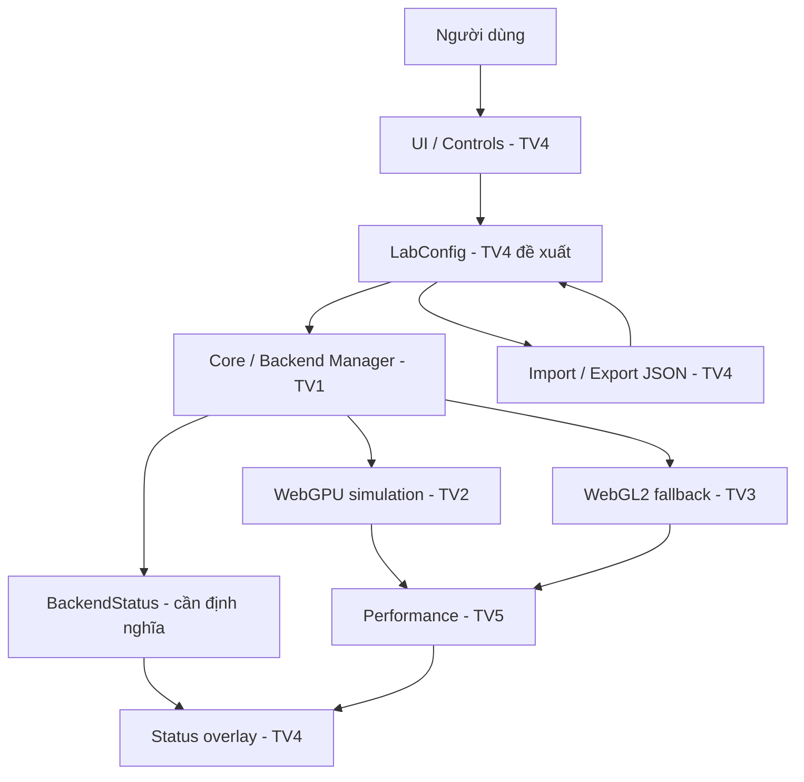

# Thiết kế tương tác & Integration Contract — TV4 v0.1

> Đây là **đề xuất hợp đồng tích hợp**, chưa được TV1/TV2/TV3/TV5 xác nhận, tránh nhầm là API dự án đã có.

## 1. Luồng dữ liệu đề xuất



## 2. State hiện có trong prototype

```ts
type SimulationMode = 'attractor' | 'vortex';
type BackendPreference = 'auto' | 'webgpu' | 'webgl2';

interface LabConfig {
  mode: SimulationMode;
  backendPreference: BackendPreference;
  particleCount: number;
  speed: number;
  particleSize: number;
  particleColor: string; // '#RRGGBB'
  strength: number;
}
```

Code thực tế: `src/presets/preset.ts`. Module `src/ui/app.ts` hiện lưu config và gọi Canvas2D preview tạm. TV1/TV2/TV3 cần review ranges và tên biến trước khi chốt interface chung.

## 3. Giao tiếp tương lai được kiến nghị

```ts
// PSEUDOCODE đề xuất; không phải interface đã tồn tại hoặc API Three.js.
interface ParticleEnginePort {
  applyConfig(config: LabConfig): Promise<void> | void;
  getBackendStatus(): { actual: 'webgpu' | 'webgl2' | 'unavailable'; reason?: string };
  pause(): void;
  resume(): void;
  reset(): void;
}

interface PerformanceSnapshot {
  fps: number | null;
  gpuTimeMs: number | null;
  gpuTimingAvailable: boolean;
}
```

Khi tích hợp: chỉ UI thay đổi trạng thái mong muốn; **Core quyết định actual backend**; TV5 cung cấp số đo; UI render trạng thái theo dữ liệu do hai bên cung cấp.

## 4. Preset JSON schema v1

```json
{
  "schemaVersion": 1,
  "app": "3D-WEB-05",
  "config": {
    "mode": "attractor",
    "backendPreference": "auto",
    "particleCount": 20000,
    "speed": 1.2,
    "particleSize": 2.5,
    "particleColor": "#6ce6ff",
    "strength": 1.5
  }
}
```

Validation hiện có: schema/app, mode, backend, particleCount (1000–50000 bước 1000), speed (0.1–3), particleSize (1–8), color `#RRGGBB`, strength (0.2–4). File trên 1MB bị từ chối qua giao diện. Phạm vi các tham số có thể phải thay đổi theo quyết định của nhóm.

## 5. Hành vi/giới hạn quan trọng

- Import lỗi phải **không sửa state cũ**.
- Import hợp lệ phải cập nhật đồng thời controls, mode, backend preference và preview.
- FPS Canvas2D trong tuần 1 là đo preview thật, **không** được dùng làm dữ liệu benchmark WebGPU/WebGL2.
- Số `particleCount` trong state phản ánh cấu hình mong muốn; Canvas2D minh họa chỉ vẽ tối đa **600** particle để tránh ngộ nhận về tải GPU.
- Fallback là việc của TV1/TV3. Không có logic tự chọn WebGL2 trong giao diện mock hiện tại.

## 6. Acceptance tests của TV4

| Case | Thao tác | Mong đợi |
|---|---|---|
| UI-01 | Chọn Vortex | Chế độ và label strength thay đổi |
| UI-02 | Kéo speed, size, color | Label cập nhật, preview phản hồi |
| UI-03 | Chọn backend WebGL2 | Preference lưu lại; backend thật vẫn “Canvas2D mock” |
| UI-04 | Export rồi Import JSON | Cấu hình không đổi sau roundtrip |
| UI-05 | Import JSON lỗi / schema v2 | Thông báo lỗi, không crash |
| UI-06 | Reset defaults | Tất cả controls về giá trị mặc định |
| UI-07 | Pause/Resume | Canvas2D dừng/tiếp tục mà không ảnh hưởng config |
| UI-08 | Resize viewport | Canvas tự co giãn, panel vẫn truy cập được |
| UI-09 | Xem GPU timing | “Không khả dụng” vì chưa có bộ đo GPU |

## 7. Bàn giao cho thành viên khác

- **TV1:** xác nhận API đồng bộ config và lifecycle renderer, sau đó thay bootstrap tạm `src/main.ts`.
- **TV2:** xác nhận mode, hệ số vật lý, giới hạn particle count và cách apply config WebGPU.
- **TV3:** xác nhận backend preference, lỗi fallback và actual backend status.
- **TV5:** xác nhận shape của perf snapshot, nhịp cập nhật FPS/timing, các trạng thái unavailable.
