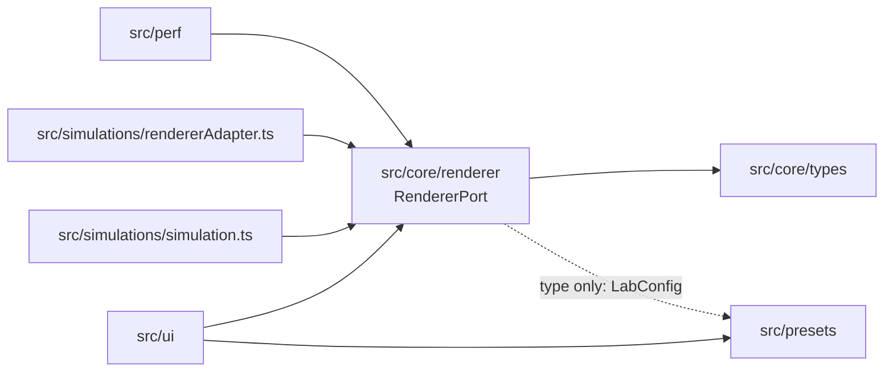

# Architecture — 3D-WEB-05 GPU Particle Lab

Owner: TV1 (`src/core/`, `src/main.ts`, `.github/`).
Status: **partially implemented**. This file records what exists today, what the
target shape is, and the rules that keep the two from drifting apart.

Related documents: [`ui-requirements.md`](01-requirements/ui-requirements.md),
[`mvp-acceptance.md`](01-requirements/mvp-acceptance.md),
[`ui-interaction-spec.md`](02-design/ui-interaction-spec.md),
[`team-ownership.md`](05-management/team-ownership.md).

---

## 1. What exists today

| Area | State | Location |
|---|---|---|
| Renderer contract | **Holds a written type, no implementation yet** | [`src/core/renderer/RendererPort.ts`](../src/core/renderer/RendererPort.ts) |
| Backend identity types | Implemented (types only) | [`src/core/types/backend.ts`](../src/core/types/backend.ts) |
| Perf sample shape (`PerformanceSnapshot`) | Implemented (type only) | [`src/core/types/measurement.ts`](../src/core/types/measurement.ts) |
| Benchmark config identity (`configHash`) | Implemented | [`src/core/measurement/configHash.ts`](../src/core/measurement/configHash.ts) |
| Preset domain (parse/serialize) | Implemented, client-side only | [`src/presets/preset.ts`](../src/presets/preset.ts) |
| UI shell | Consumes an injected RendererPort; no backend init in UI | [`src/ui/app.ts`](../src/ui/app.ts) |
| Simulation preview | Canvas2D mock removed; composition root injects a renderer port (placeholder until #12) | `src/main.ts` |
| Renderer adapter (one, backend-flagged) | Not started | `src/simulations/rendererAdapter.ts` (planned) |
| Composition root | Implemented (unavailable placeholder port until #12) | [`src/main.ts`](../src/main.ts), [`src/composition.ts`](../src/composition.ts) |
| Simulation: physics + material tree | Not started | `src/simulations/simulation.ts`, `src/simulations/shared/` (planned) |
| Perf collector | RendererPort frame sampler implemented; warm-up and cadence are configured by caller | [`src/perf/collector.ts`](../src/perf/collector.ts) |

There is **one** renderer, not one per backend. `src/simulations/webgpu/` and
`src/simulations/webgl2/` hold backend-specific parts only (capability probe,
timestamp query), never a second copy of the simulation rules.
| Server, auth, persistence | **Out of scope for this repo** | — |

Without an injected port the default build reports unavailable and keeps preset
import/export available. FakeRenderer is used only by the explicit E2E harness;
its labels/measurements are test inputs, never WebGPU/WebGL2 benchmark evidence.

## 2. Dependency rules



Solid arrows are runtime dependencies; the dotted arrow is type-only. Arrows
never point back toward `src/ui`.

Rules:

1. `src/core/types/` imports nothing. It is the leaf.
2. `src/core/renderer/` may import types only. No DOM, no `three`, no network.
3. `src/simulations/*` may import `src/core/`; **never** the reverse.
4. `src/ui/` may not import `src/simulations/*` directly — only `RendererPort`.
5. `src/presets/` may not import `src/ui/`.

Rule 4 is exercised by the UI port consumer and the fake-port interaction tests.
The production adapter and composition-root injection are still missing (D-01).
See [UI port handoff](04-testing/UI-renderer-port-2026-10-24.md) for lifecycle,
default config application and the no-port compatibility path.

## 3. Backend boundary

`BackendPreference` (`auto | webgpu | webgl2`) is a request. `ActualBackend`
(`webgpu | webgl2 | unavailable`) is a fact produced by the engine.

**INV-1 — measurement integrity.** A benchmark row must record the backend that
actually ran, and `gpuTimeMs` is `null` if and only if `gpuTimingAvailable` is
false. Recording the requested backend, or writing `0` for "not measured",
invalidates every comparison the project is built to produce.

`RendererStatus` encodes this directly: `requested` exists only to explain a
fallback, and `actual` is the only backend identity a benchmark row may store.

## 4. Renderer contract

`RendererPort` (see the file for full doc comments):

```ts
init(target: RendererTarget): Promise<ActualBackend>
applyConfig(config: Readonly<LabConfig>): void
start() / pause() / reset()
getStatus(): RendererStatus
dispose(): void
```

Design notes:

- `init` **resolves** with `unavailable` instead of throwing, because "no GPU
  backend" is a normal state the UI must render, not an exception.
- `applyConfig` is called on every slider tick; it must not allocate GPU
  resources or start a request. Only an explicit preset save reaches a server.
- The contract is transport-free and DOM-free so that `tests/unit/renderer-port.test.ts`
  can exercise callers with a fake — no canvas, no GPU.
- **`backendPreference` is read at `init()`.** Changing it later through import
  or reset does not switch a running renderer; the next `init()` applies it.
  This is a decision by TV1 on 2026-10-22, not an open question: UC-03
  (`01-requirements/use-cases.md`) describes choosing a backend and then
  initialising it, and `UI-FR-04` requires displaying the backend that actually
  ran. Neither requires hot-swapping. The former D-08 is resolved by this rule.

When a real backend is added, `ThreeRendererAdapter` will be **one** class with a
backend flag (`forceWebGL`), not two classes: `three/webgpu` selects the backend
at construction and exposes `renderer.backend.isWebGPUBackend`. Two classes
would duplicate the same TSL material tree.

### 4.1 Who owns each contract

| Contract | Defined in | Producer | Consumers | Owner |
|---|---|---|---|---|
| `RendererPort`, `RendererStatus` | `src/core/renderer/RendererPort.ts` | TV1 | UI, perf, both renderers | TV1 |
| `ActualBackend`, `BackendPreference` | `src/core/types/backend.ts` | TV1 | renderer, perf, UI | TV1 |
| `LabConfig`, preset JSON v1 | `src/presets/preset.ts` | TV4 | UI, renderer, future server | TV4 |
| `PerformanceSnapshot`, `configHash` | `src/core/types/measurement.ts`, `src/core/measurement/configHash.ts` | TV1 | TV5, ingestion | TV1 |

A contract changes only with its owner's review. Consumers adapt; the contract
does not bend per consumer.

Who writes which file is in [`05-management/team-ownership.md`](05-management/team-ownership.md);
this table is about contracts, not about people.

## 5. Data ownership

| Data | Owner | Rule |
|---|---|---|
| Preset JSON (v1) | Preset module | `schemaVersion: 1`, unknown keys rejected on parse |
| Backend identity | Renderer port | Only the engine may produce `ActualBackend` |
| Performance samples | Perf collector | Must carry `actual`, never the requested backend; unavailable GPU timing is `null` |

There is no persistence layer in this repository yet. Any claim about stored
data in the current codebase would be false.

### 5.1 Benchmark configuration identity (`configHash`)

`configHash` names the configuration a sample was measured under. Two samples
may be aggregated only when they agree on `(mode, configHash) × actual`; across
a hash boundary they are different experiments.

**Included fields** — the `LabConfig` values that change the work the GPU does:
`mode`, `particleCount`, `speed`, `particleSize`, `strength`.

**Excluded, with reasons:**

- `backendPreference` — a request, not a measurement condition. The backend
  that ran is stored separately as `actual` (INV-1).
- `particleColor` — a per-frame uniform; it changes appearance, not step cost
  or particle count. Excluding it lets runs that differ only in colour share
  measurements.
- `schemaVersion`, `app` — preset envelope, not measurement input.

**Normalization.** The hash input is one JSON object, keys in alphabetical
order, no whitespace, numbers rounded to 3 decimal places and written without
trailing zeros (`1.2`, not `1.20`):

```json
{"mode":"attractor","particleCount":20000,"particleSize":2.5,"speed":1.2,"strength":1.5}
```

Key order is fixed by this rule, not by object iteration order.

**Algorithm.** SHA-256 over the UTF-8 bytes of that string, lowercase hex,
64 characters.

**Invalid or missing values.** A hash is computed only for a config that has
already passed `parsePreset` (`src/presets/preset.ts`): it rejects
out-of-range values and unknown keys, requires `particleCount` to be an integer
multiple of 1000 (v1), and rebuilds the object from the seven known fields, so
unknown keys never reach the hash. Invalid input produces no sample at all —
never a hash of a defaulted or partially filled config.

**Status.** Defined and implemented by TV1 on 2026-10-22:
`canonicalConfig()` and `configHash()` in
`src/core/measurement/configHash.ts`, covered by
`tests/unit/measurement.contract.test.ts`. `configHash()` is async because
SHA-256 comes from Web Crypto (`crypto.subtle`), which also works in the
browser with no dependency added. It rejects missing, non-finite or invalid
`mode` values with a `TypeError`; range checks stay in `parsePreset`.

## 6. Known debt

| ID | Debt | Where |
|---|---|---|
| D-01 | UI consumes RendererPort and mock is removed; real adapter/composition-root injection still pending | `src/main.ts` (issues #12/#15) |
| D-02 | Domain module touches the DOM (`downloadPreset`) | `src/presets/preset.ts` |
| D-03 | Unchecked cast from a DOM value into `LabConfig` | `src/ui/app.ts` |
| D-04 | Backend label hardcoded in the UI template | `src/ui/app.ts` |
| D-05 | `serializePreset` re-parses its own output to self-validate | `src/presets/preset.ts` |
| D-06 | `RendererPort` depends on `src/presets` for the `LabConfig` type | `src/core/renderer/RendererPort.ts` |
| D-07 | UI injection API is available; TV1 supplies the initialized port from main. Full live-status acceptance remains #14 | `src/main.ts`, `src/ui/overlays/statusOverlay.ts` |

D-06 disappears once the config types move into `src/core/types/`; that change
needs TV4's agreement because `src/presets/` is theirs.

D-08 is retired: a changed `backendPreference` applies on the next `init()`
(§4). The ID is not reused.

Open decisions that are not debt yet — the WebGL2 stepping path and the
`LabConfig` freeze date — are tracked in
[`05-management/team-ownership.md`](05-management/team-ownership.md) §7.
Evidence on the WebGL2 path is in
[`03-research/webgl2-simulation-options.md`](03-research/webgl2-simulation-options.md).

## 7. Verification

```bash
npm ci
npm run typecheck     # tsc --noEmit over src/
npm test              # Vitest unit and contract tests
npm run verify        # source/tests typecheck, unit, Chromium E2E, production build
```

`RendererPort` itself adds no runtime code; the contract test exists so that a
future implementation cannot quietly change what `actual` or `gpuTimeMs` mean.
